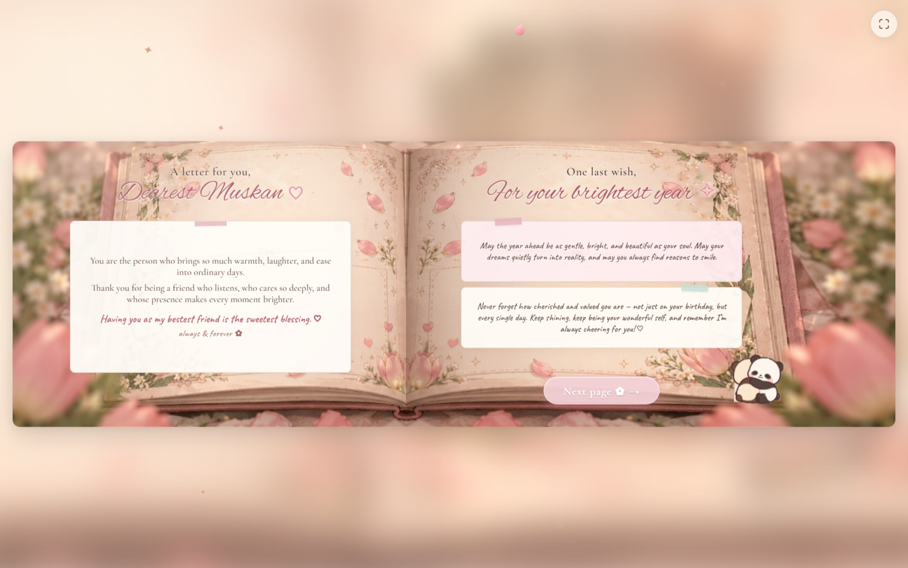
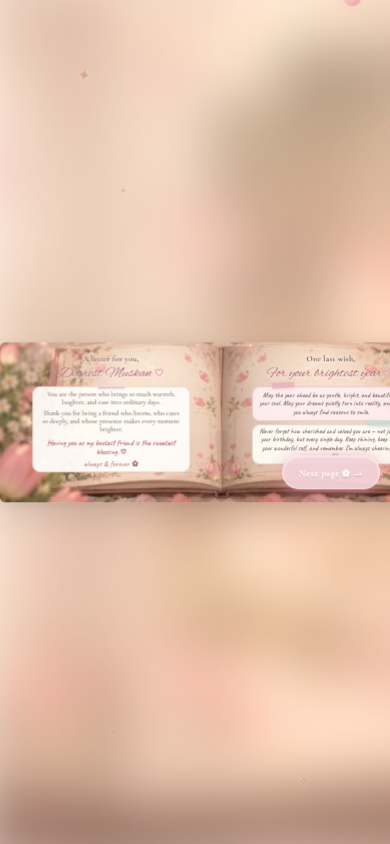
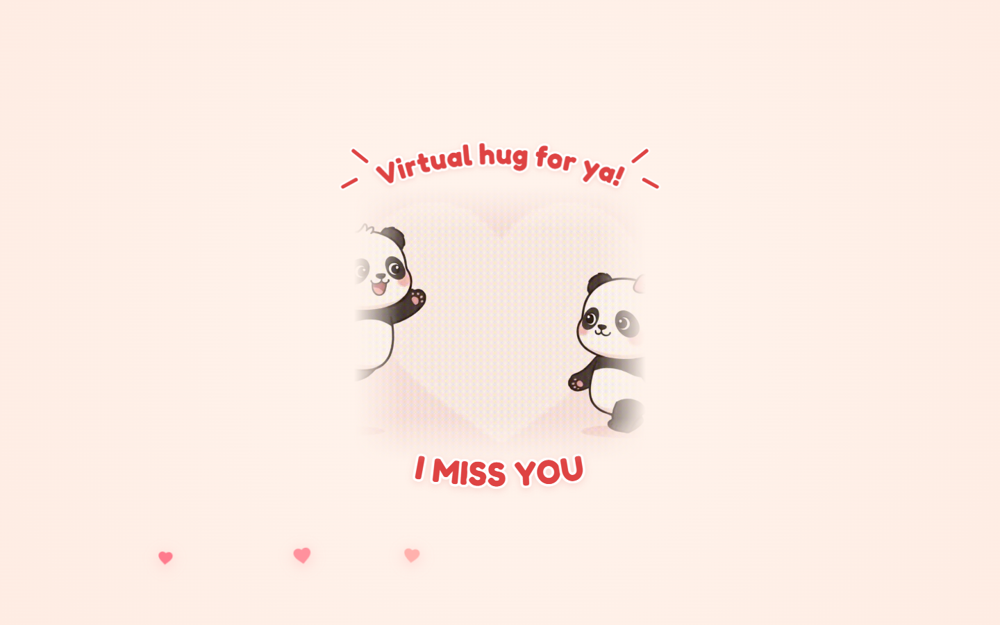

# A Little Spring Garden & Birthday Scrapbook For Muskan 🌷

An illustrated, interactive birthday surprise website crafted with romantic vintage watercolor aesthetics, real CSS 3D transforms, and delicate animations.

---

## ✨ Complete Experience Journey

1. **The Spring Garden Landing Page (`index.html`)**
   - Warm ivory and blush-cream atmosphere framed by illustrated pink tulips and soft foliage.
   - Gently drifting petals, twinkling stars, and an adorable cartoon panda peeking from the corner.
   - Gateway button: *"There's something I made for you ✿ →"*.

2. **The Handmade Keepsake Scrapbook (`scrapbook.html`)**
   - **Cover**: Vintage leather texture, brass ornamental corners, and cover dedication: *"To the best person I have met and to the bestest friend"*.
   - **3D Book Opening**: Tapping *"Open the book ✧"* swings open the front cover with 3D perspective into the open floral album.
   - **Spread 1 (Birthday Spread)**: "Happy Birthday, Muskan ♡" paired with an interactive 2-tier strawberry birthday cake and 5 flickering candle flames.
   - **Candle Blowing**: Tapping *"Blow the candles ✿"* extinguishes the flames, curls wispy smoke trails upward, reveals handwritten wish note cards, and transforms the button to *"next page ✿ →"*.
   - **Flawless Central-Binding 3D Page Turn**: The right paper leaf lifts and hinges strictly at the center spine binding crease ($x = 44.58\%$) while the book cover and garden stay completely stationary, turning to reveal Spread 2.
   - **Spread 2 (Final Keepsake Spread)**:
     - **Left Page**: A heartfelt appreciation letter on vintage washi-taped stationery celebrating her friendship (*"Having you as my bestest friend is the sweetest blessing. ♡"*).
     - **Right Page**: Warm birthday blessings on pastel wish cards, an illustrated smiling panda in the corner, and the final action button: *"Next page ✿ →"*.
   - **3D Book Closing Animation**: Tapping *"Next page ✿ →"* gracefully folds the book closed shut in 3D around its spine, settles peacefully, and smoothly fades into the final surprise.

3. **Virtual Hug Surprise (`hug.html`)**
   - The finale page: An affectionate animated panda hug with floating hearts and curved typography (*"A VIRTUAL HUG FOR YA! ❤️"*).

---

## 📸 Screenshots

| Spread 1: Cake & Lit Candles | Spread 1: Candles Blown |
|:---:|:---:|
|  |  |

| Spread 2: Final Keepsake Spread | Spread 2: Mobile View |
|:---:|:---:|
|  |  |

| Virtual Hug Finale |
|:---:|
|  |

---

## 🚀 Running Locally

No build tools or external dependencies needed:

```bash
# Using Python's built-in HTTP server:
python -m http.server 3000
```

Open `http://localhost:3000/` in your browser (or access via your local Wi-Fi IP on mobile).
