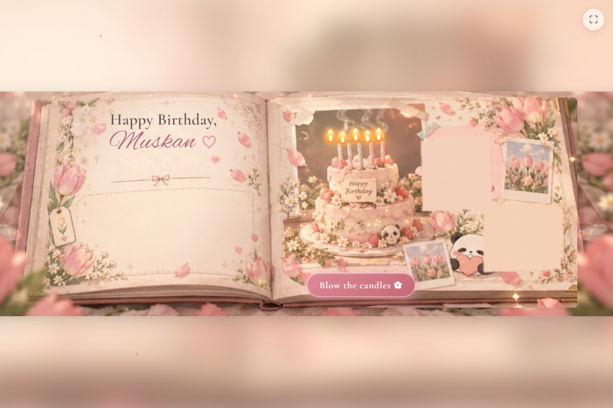
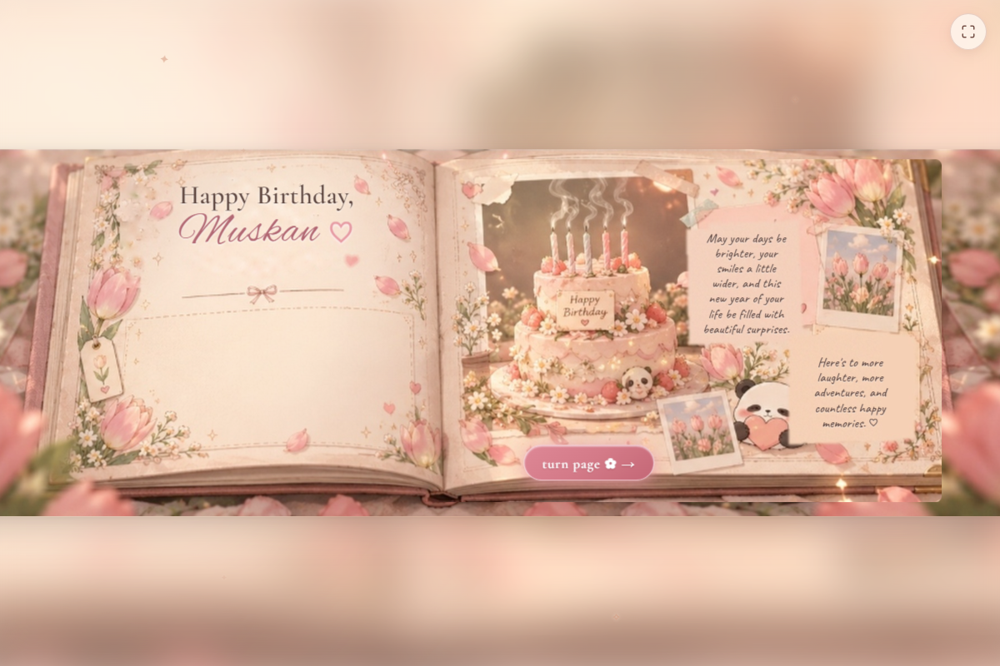
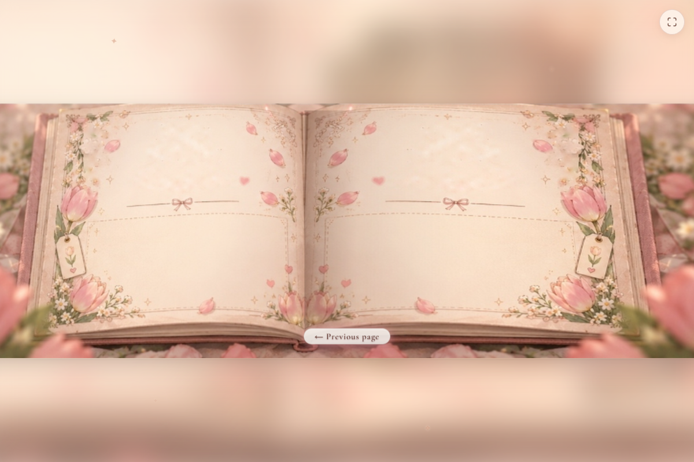

# A Little Spring Garden & Birthday Scrapbook For Muskan 🌷

An illustrated, interactive birthday surprise website crafted with romantic vintage watercolor aesthetics, real CSS 3D transforms, and delicate animations.

---

## ✨ Experience Journey

1. **The Spring Garden Landing Page (`index.html`)**
   - Warm ivory and blush-cream atmosphere framed by illustrated pink tulips and soft foliage.
   - Gently drifting petals, twinkling stars, and an adorable cartoon panda peeking from the corner.
   - Elegant gateway button: *"There's something I made for you ✿ →"*.

2. **The Handmade Keepsake Scrapbook (`scrapbook.html`)**
   - **Cover**: Vintage leather texture, brass ornamental corners, and a sweet dedication.
   - **3D Book Opening**: Opens smoothly with perspective into a two-page floral spread.
   - **Birthday Spread**: A personal birthday wish paired with an interactive 2-tier strawberry birthday cake.
   - **Interactive Candle Blow**: Tap *"blow the candles ✿"* to extinguish the 5 flickering flames—wispy smoke curls upward, hidden handwritten wish notes appear, and the button transforms to *"turn page ✿ →"*.
   - **Flawless Central-Binding 3D Page Flip**: The right page leaf lifts and turns strictly from the central spine crease ($x = 44.58\%$) without rotating the book cover, table, or floral borders, revealing a blank vintage spread ready for more memories. Includes a *"← Previous page"* return button.

3. **Virtual Hug Surprise (`hug.html`)**
   - An affectionate animated panda hug with floating hearts and curved typography.

---

## 📸 Screenshots

| Birthday Spread (Candles Lit) | Blown Candles & Wish Notes |
|:---:|:---:|
|  |  |

| 3D Page Turn Settled | Mobile Responsive View |
|:---:|:---:|
|  |  |

---

## 🚀 Running Locally

No build tools or dependencies required—runs directly in any modern browser:

```bash
# Using Python's built-in HTTP server:
python -m http.server 3000
```

Open `http://localhost:3000/` in your browser.

---

## 🌐 Deploying to GitHub Pages

1. In your GitHub repository, navigate to **Settings** > **Pages**.
2. Under **Build and deployment** > **Source**, select **Deploy from a branch**.
3. Choose the `main` branch and `/ (root)` folder, then click **Save**.
4. The live surprise will be available at:  
   `https://sahanion.github.io/tswm/`
